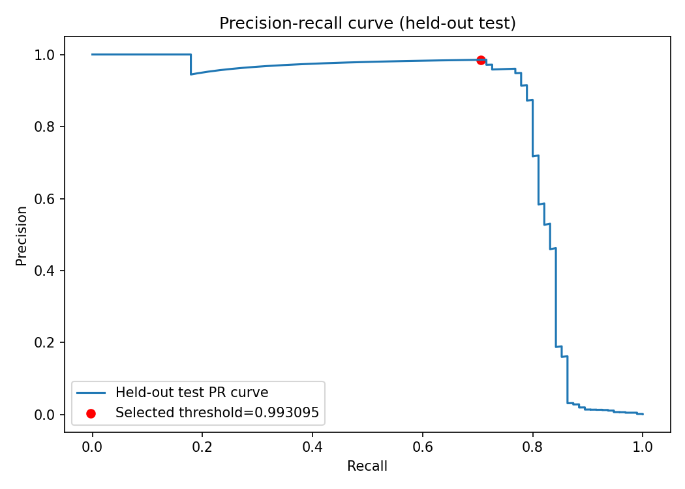
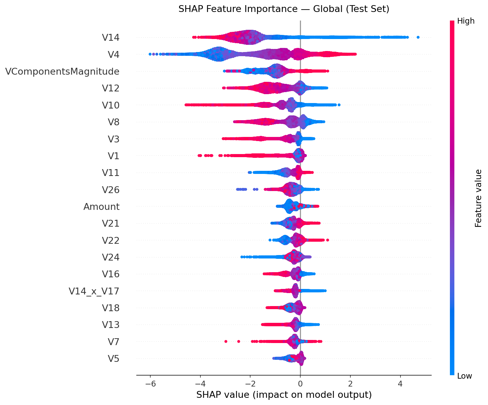
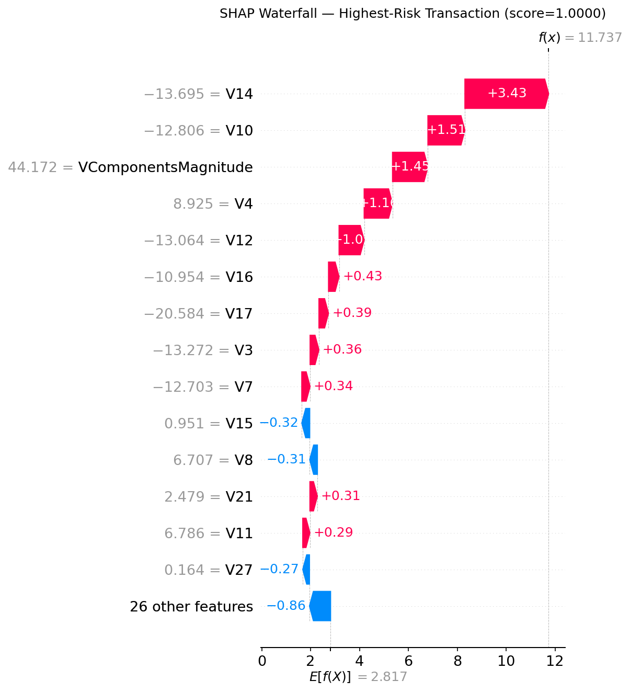

# Credit Card Fraud Detection Pipeline

This project trains and serves an imbalanced-fraud scoring model on the
Kaggle/ULB credit-card dataset. The chronological evaluation leads the report:
XGBoost achieved test AUPRC **0.7983 (95% bootstrap CI 0.7032–0.8788)**,
precision `0.9464`, and recall `0.7067` on later elapsed-time records.

The verified environment is Python `3.12.5` with pandas `2.2.2`, NumPy
`1.26.4`, scikit-learn `1.5.1`, and XGBoost `2.1.0`. The pipeline uses seed
`42`; reproduce the experiment with `python train.py` after downloading the
dataset described below. These are offline benchmark results, not a guarantee
of future or production performance. False positives create investigation
workload, while false negatives allow fraudulent transactions to pass
undetected; no production cost or latency benchmark has been established.

Run the reproducible pipeline after downloading `data/creditcard.csv`:

```bash
python train.py
```

The following examples are from the **deduplicated stratified test set**, not
the chronological test set used for the headline result. They are generated
from [`prediction_examples.json`](outputs/evaluation/prediction_examples.json)
and verified against the saved artifacts.

| Example | Evaluation context | True label | Score | Predicted class | Threshold |
|---|---|---:|---:|---:|---:|
| Correctly detected fraud | Deduplicated stratified test | 1 | 0.999992 | 1 | 0.993095 |
| False negative | Deduplicated stratified test | 1 | 0.990442 | 0 | 0.993095 |

These are offline dataset examples, not guarantees for new transactions.

## Setup

```bash
git clone https://github.com/DevanshXerc90/Fraud-detection-pipeline.git
cd Fraud-detection-pipeline
pip install -r requirements.txt
```

Download the [Kaggle dataset](https://www.kaggle.com/datasets/mlg-ulb/creditcardfraud)
and save it as `data/creditcard.csv`. The dataset is not committed.

## Architecture and data flow

```text
CSV -> split policy -> fitted feature engineering -> fitted RobustScaler
    -> model comparison -> validation threshold selection
    -> held-out evaluation -> model/preprocessor artifacts -> FastAPI
```

The default split removes exact duplicate rows before a stratified
70%/10%/20% split. Use `DataLoader.split(..., deduplicate=False)` to reproduce
the historical duplicate-containing split. Feature engineering and scaling
are fitted on training data only. Model selection uses five-fold mean AUPRC on
the training partition; validation selects the operating threshold; the test
set is evaluated once. The chronological path is separate: it sorts by
elapsed `Time`, fits preprocessing and each candidate model on the earlier
70%, selects the model with the highest validation AUPRC on the next 10%, and
selects that model's F1-maximising threshold from the same validation
predictions. Only then is the later 20% evaluated. This temporal selection is
statistically fragile because validation contains only 33 fraud cases; the
reported bootstrap intervals quantify test-sample variation and do not include
model- or threshold-selection uncertainty.

## Chronological evaluation

`Time` is elapsed seconds, not wall-clock time. Sorting by `Time` gives:

| Split | Rows | Fraud cases |
|---|---:|---:|
| Earlier train | 199,364 | 384 |
| Validation | 28,481 | 33 |
| Later test | 56,962 | 75 |

XGBoost was selected on temporal validation AUPRC `0.8436`. At the threshold
`0.934245` selected from the 33-fraud validation set:

| Metric | Value | Bootstrap 95% CI |
|---|---:|---:|
| AUPRC | 0.7983 | 0.7032–0.8788 |
| Precision | 0.9464 | 0.8863–1.0000 |
| Recall | 0.7067 | 0.6026–0.8052 |

Intervals use 1,000 percentile-bootstrap samples of the temporal test set;
replicates without positives are counted and skipped. They measure test-sample
uncertainty and do not include uncertainty from selecting a model or threshold.
The temporal threshold was tuned using only 33 validation frauds.

## Stratified evaluation

The default deduplicated stratified run contains 198,607/331 train,
28,373/47 validation, and 56,746/95 test rows/frauds. XGBoost was selected by
five-fold mean AUPRC (`0.8582`, std `0.0643`); Random Forest was close
(`0.8543`, std `0.0587`) and is not claimed statistically inferior.

At the validation-selected threshold `0.993095`, the test results are:

| Metric | Value | Bootstrap 95% CI |
|---|---:|---:|
| AUPRC | 0.8111 | 0.7277–0.8878 |
| Precision | 0.9853 | 0.9524–1.0000 |
| Recall | 0.7053 | 0.6144–0.7901 |

The selected threshold confusion matrix is TN=`56,650`, FP=`1`, FN=`28`,
TP=`67`. These random and temporal metrics use different distributions and
are not directly comparable as if they were the same experiment.

## Duplicate sensitivity

Exact duplicates were measured across every feature column plus `Class`.
The dataset has 1,854 duplicate rows in 773 groups, with 1,081 occurrences
beyond each group's first row. In the historical stratified split, 8 of the
98 test frauds have an identical twin in train or validation; 22 of all 492
fraud rows have a twin in another stratified partition.

| Evaluation | Test rows/frauds | Threshold | AUPRC | Precision | Recall |
|---|---:|---:|---:|---:|---:|
| Current duplicate-containing split | 56,962 / 98 | 0.937918 | 0.8812 | 0.9405 | 0.8061 |
| Deduplicate before splitting | 56,746 / 95 | 0.993095 | 0.8111 | 0.9853 | 0.7053 |
| Current split, no train/validation twin in test | 56,618 / 90 | 0.937918 | 0.8683 | 0.9342 | 0.7889 |

The deduplicated results differ materially from the historical results, so
the default now deduplicates before splitting. This is a conservative
evaluation policy to prevent identical rows from being distributed across
partitions and making performance look better than it may be; it does not
prove that repeated transactions are invalid, remove all forms of leakage, or
improve real-world performance. Deduplication happens before the stratified
split and can remove legitimate repeated events from that evaluation. The
historical `deduplicate=False` mode remains available to reproduce the
duplicate-containing comparison. All three result objects, thresholds,
confusion counts, and 1,000-sample bootstrap intervals are in
[`models/results.json`](models/results.json).

## Threshold trade-offs

The selected threshold (`0.993095`), the default comparison threshold (`0.5`),
and the validation-selected threshold targeting approximately 90% recall are
compared below. Test results are descriptive.

| Threshold | TN | FP | FN | TP | Test precision | Test recall |
|---:|---:|---:|---:|---:|---:|---:|
| 0.993095 selected | 56,650 | 1 | 28 | 67 | 0.9853 | 0.7053 |
| 0.5 | 56,644 | 7 | 20 | 75 | 0.9146 | 0.7895 |
| 0.002949, ~90% validation recall | 56,004 | 647 | 13 | 82 | 0.1125 | 0.8632 |

The precision-recall curve is generated from held-out predictions:



Source data is [`precision_recall_curve.json`](outputs/evaluation/precision_recall_curve.json).

## Features

| Feature | Formula or assumption |
|---|---|
| `LogAmount` | `log1p(Amount)` |
| `HourOfDay` | `floor(Time / 3600) mod 24`; elapsed-time proxy |
| `HourSin`, `HourCos` | Circular encoding of `HourOfDay` |
| `IsNightTime` | Configured modulo-24-hour bucket, not verified wall-clock time |
| `V14_x_V17` | Product of PCA components `V14` and `V17` |
| `VComponentsMagnitude` | Euclidean magnitude of the PCA vector |
| `IsMicroTx` | `Amount <= 1.0` dataset-unit indicator, not a causal claim |
| `AmountPercentile` | Percentile against the fitted training amount distribution |
| `TimeSinceFirstTxNorm` | Normalized elapsed time using fitted training bounds |

## API and artifacts

Start the API and open the interactive documentation:

```bash
uvicorn src.api.main:app --host 0.0.0.0 --port 8000
```

Then visit `http://localhost:8000/docs`. A verified `/predict` request using
the correctly detected fraud example above is:

```bash
curl -X POST http://localhost:8000/predict ^
  -H "Content-Type: application/json" ^
  -d "{\"Time\":41237.0,\"V1\":-10.28178404,\"V2\":6.302384784,\"V3\":-13.27171803,\"V4\":8.925115476,\"V5\":-9.975578311,\"V6\":-2.832513464,\"V7\":-12.70325266,\"V8\":6.706845839,\"V9\":-7.078423958,\"V10\":-12.80568319,\"V11\":6.786058302,\"V12\":-13.06423989,\"V13\":1.179524511,\"V14\":-13.69487304,\"V15\":0.951479176,\"V16\":-10.95428573,\"V17\":-20.58359279,\"V18\":-7.517262132,\"V19\":2.872353636,\"V20\":-0.247647528,\"V21\":2.479413508,\"V22\":0.366932842,\"V23\":0.042804648,\"V24\":0.478278892,\"V25\":0.157770818,\"V26\":0.329900959,\"V27\":0.163504341,\"V28\":-0.485552213,\"Amount\":118.3}"
```

Verified response from the saved artifacts:

```json
{"fraud_score":0.999992,"is_fraud":true,"risk_level":"CRITICAL","threshold":0.9930950999259949}
```

Endpoints are `/health`, `/predict`, `/predict/batch`, and `/docs`.
The response field is `fraud_score`, an uncalibrated positive-class score,
not a calibrated probability. Risk labels are LOW `<0.4`, MEDIUM `0.4–<0.7`,
HIGH `0.7–<0.9`, and CRITICAL `>=0.9`; they are display bands separate from
the binary decision threshold.

Training writes `model.pkl`, `model.xgb.json`, `preprocessor.pkl`,
`feature_engineer.pkl`, `metadata.json`, and `results.json`. The native JSON
XGBoost artifact produced exactly the same predictions as the joblib model in
the verification run. Load pickle/joblib files only from trusted sources.

The local trainer logs one MLflow run per model. Evidence from `mlruns/` is
summarized in [`docs/mlflow_runs.md`](docs/mlflow_runs.md). No remote MLflow
service is claimed.

SHAP output for the selected model:





## Tests and project structure

```bash
pytest -q
python -m compileall -q src train.py tests
docker compose up --build
```

```text
src/data/       loading, splitting, preprocessing
src/features/  fitted feature engineering
src/models/    trainers, evaluation helpers, SHAP
src/api/       FastAPI application
tests/         unit and API tests
train.py       end-to-end training command
models/        generated compatible artifacts and metrics
outputs/       generated plots and prediction examples
```

